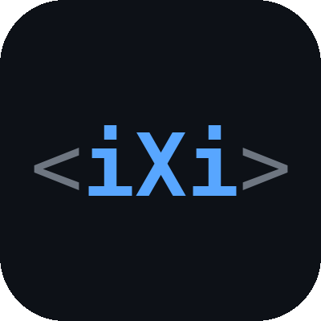

  

<strong>Technology for cooperation.</strong>

  <a href="#building-blocks">Building blocks</a> · <a href="#agentic">Agentic</a> · <a href="#governance">Governance</a>

I'm Aron Greenspan. These repos are a decade of lessons from building software, packaged so I don't have to figure the same things out on every project. The building blocks are those answers. Coding agents ignored them and wrote parallel versions, so I built Foundry to point them at what the codebase already has. The long-term goal is tools for people, and their agents, to cooperate.

---

## Building blocks

**Stop rediscovering what you need to build.**

On every product I built, I had to answer the same questions: who can see this record, which state change is allowed right now, how one rule runs in memory, in Prisma and in SQL. These libraries are the answers, and template puts them together. Six of the libraries run in production at the company where I work.

### template

Like shadcn, but for the whole SaaS backend. You start from it and own the code. It runs on Bun, Hono, Prisma 7 and React, with auth, multi-tenancy, permissions, jobs, audit logging and field-level encryption already wired in. If your coding agent writes its own versions instead, Foundry points it back at these.

[GitHub](https://github.com/inixiative/template)

### The packages

In dependency order.

- **[json-rules](https://github.com/inixiative/json-rules)**: one rule AST compiles to in-memory checks, Prisma queries and SQL `WHERE` clauses. Serializable, with type-safe operators, paths and binding.
- **[permissions](https://github.com/inixiative/permissions)**: RBAC, ABAC and ReBAC with entitlements and delegates, decided on your own records with no separate store to sync. About a thousand lines of core.
- **[transitions](https://github.com/inixiative/transitions)**: declarative lifecycles on json-rules. Which move is legal now, for this actor, on this record.
- **[prisma-map](https://github.com/inixiative/prisma-map)**: a runtime model map (fields, relations, foreign-key direction, enums) from a generated Prisma client.
- **[atlas](https://github.com/inixiative/atlas)**: a codebase map built from `@atlas` annotations; `atlas check` fails CI when they drift.
- **[rules-builder](https://github.com/inixiative/rules-builder)**: a headless rule builder that offers only what the engine can run. [Live demo](https://www.inixiative.com/rules-builder/).
- **[config](https://github.com/inixiative/config)**: the shared toolchain and theme for every repo here, with a CLI that checks, syncs and releases them together.
- **[gloss](https://github.com/inixiative/gloss)**: comment-free source, with explanations in a sidecar tree.

Paused, not recommended for use: [hivemind](https://github.com/inixiative/hivemind), [conditional-form](https://github.com/inixiative/conditional-form).

**[Full vocabulary](https://www.inixiative.com/vocabulary.html)** of every primitive ([source](https://github.com/inixiative/.github/blob/main/VOCABULARY.md)).

---

## Agentic

**An agent that works like you do.** Giving your work a voice.

Coding agents kept writing their own versions of what my repos already had, such as a second auth path beside the existing one. Every agent session starts half-amnesiac. You pay a re-alignment tax: re-explaining your conventions, your decisions, your taste. The model and the harness are outside your control. Your corpus (docs, rules, `CLAUDE.md`) is the one layer you do control, and Foundry gives you a tool to control it. The agent does what you want when it's told the right thing. The bet is that your corrections compile into docs that tell it automatically. In early runs, we gave the agent Aron's corrections before it planned, and the plans came out right. Oracle runs the tuning loop.

### Foundry

The workspace around your agent: Claude Code, Codex and Muse, plus ACP apps. The voice of the codebase.

- **Stop repeating yourself to Claude.** What you've already decided reaches every session. Wardens notice what your request touches and point at what your codebase already has and where it's written down. They never block; your agent decides. *(Built; off by default. Turn the chorus on in settings.)*
- **Every agent you pay for, in one place.** Claude Code, Codex and Muse on your own subscriptions, a worker per thread, every session captured.
- **Stop being a meat proxy.** Your agent, their agent and the people in one thread, hashing out the work. *(Host side built; joiner view in progress.)*
- **Stop checking a dozen apps.** Whatever comes in (a Slack DM, a review request, an email) reaches you already researched and in context. It's read as data, so it can't instruct your agent. *(In progress: Kingdom streams the events; Foundry doesn't receive or sort them yet.)*
- **Set up your repo.** Foundry reads your repo and builds the docs and Wardens. *(In progress.)*

[GitHub](https://github.com/inixiative/foundry) · [npm](https://www.npmjs.com/package/@inixiative/foundry)

### Kingdom

Everything you're doing, in one place. Your apps, data, AI and agents across every team you're in. Decide who and what can reach each piece, for how long, and take it back. Bring your agent.

[kingdom.inixiative.com](https://kingdom.inixiative.com)

### Signet

Pass-through execution with tracking and audit, built on the permissions library. The way anything uses an integration through Kingdom: a revocable pass on the owner's terms.

[GitHub](https://github.com/inixiative/signet) · [npm](https://www.npmjs.com/package/@inixiative/signet)

### KCP, the Kingdom CLI Proxy

Built so far: `kcp login`, `status` and `map`. Next: Kingdom runs your provider CLIs with its stored credentials and streams the output back, so none sit on your machine. *(In progress.)*

[GitHub](https://github.com/inixiative/kcp) · [npm](https://www.npmjs.com/package/@inixiative/kcp)

### Archive

Keeps every agent session. Local-first, and syncs to the archives you choose.

[GitHub](https://github.com/inixiative/archive) · [npm](https://www.npmjs.com/package/@inixiative/archive)

### Oracle

Measures whether a correction stuck, and tunes the docs and Wardens.

### agent-session

Drive Claude Code, Codex and Muse as persistent streaming sessions behind one interface.

[GitHub](https://github.com/inixiative/agent-session) · [npm](https://www.npmjs.com/package/@inixiative/agent-session)

### bench: Do I Still Have a Job?

Our own challenge set for coding agents, from staff to architect tiers. Results are from June 2026; more challenges are coming.

[bench.inixiative.com](https://bench.inixiative.com)

---

## Governance

The long-term goal is tools for people, and their agents, to cooperate. The whitepaper and the proposals are designs for cooperation at scale: how groups set rules, hold each other accountable, and invest together without a central referee.

[The proposals](https://www.inixiative.com/proposals) · [whitepaper on GitHub](https://github.com/inixiative/whitepaper)

---

## Open source

MIT by default: the building blocks, Archive, agent-session, Signet, KCP, and Foundry's core engine and ACP adapter. Foundry's app is source-available under BSL 1.1: free to use, including at work, but not to resell; it becomes MIT in April 2030. Kingdom and Oracle are closed.

We open the pieces people build on, and keep the hosted service and the tuning closed so the project can sustain itself.

---

**Contributors:** Aron Greenspan.

[www.inixiative.com](https://www.inixiative.com) · [Substack](https://inixiative.substack.com) · [X](https://x.com/inixiative)
